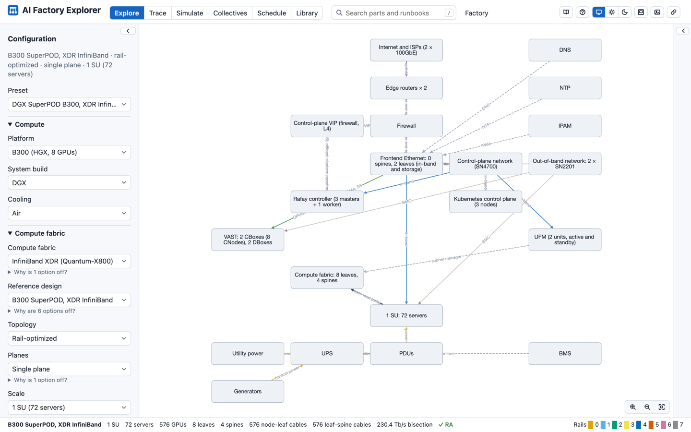
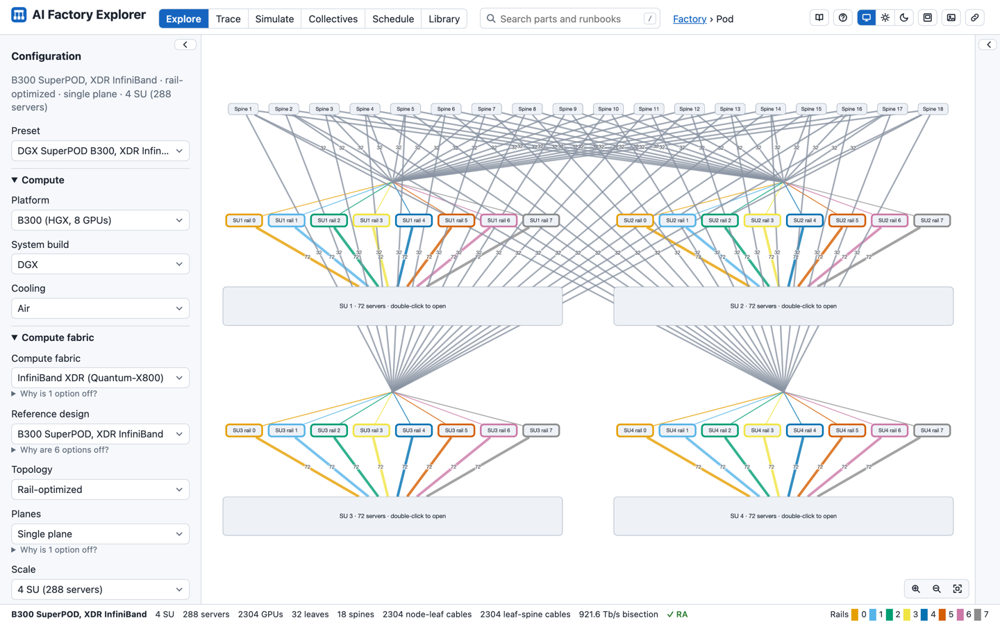
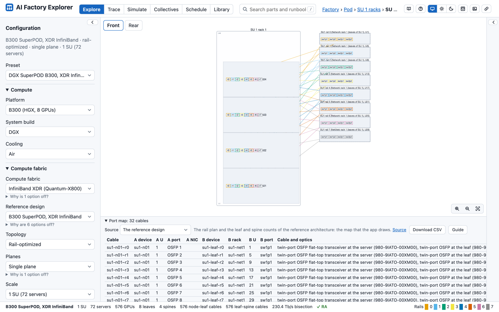
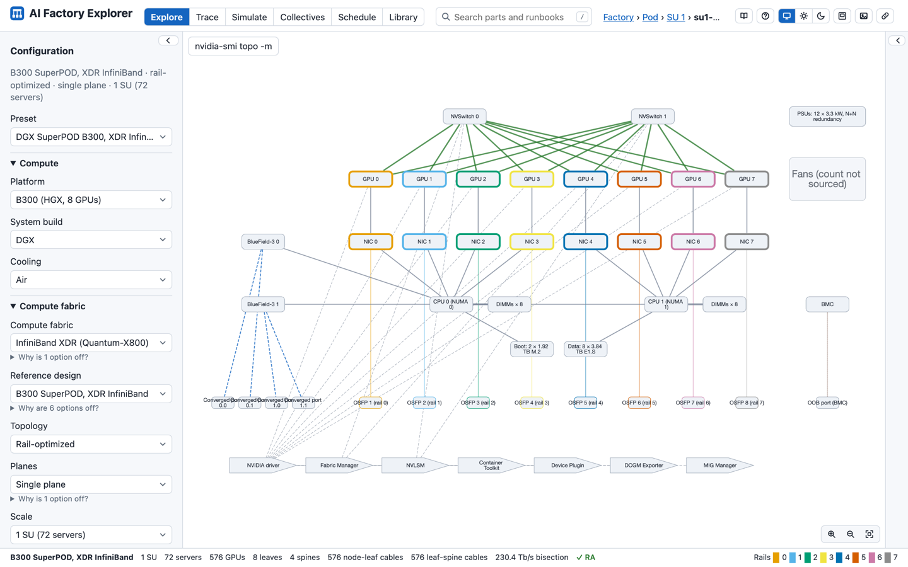
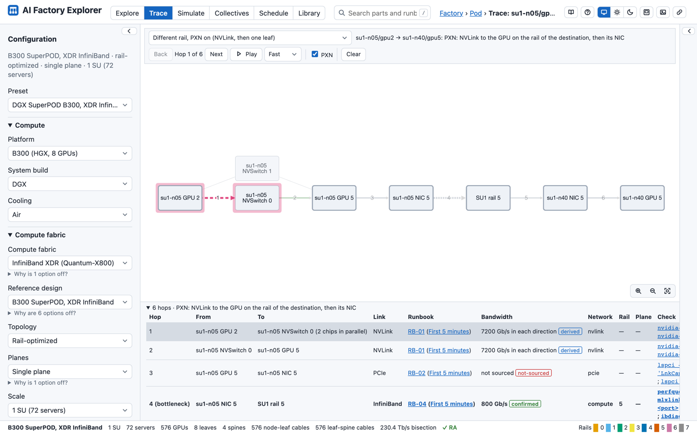
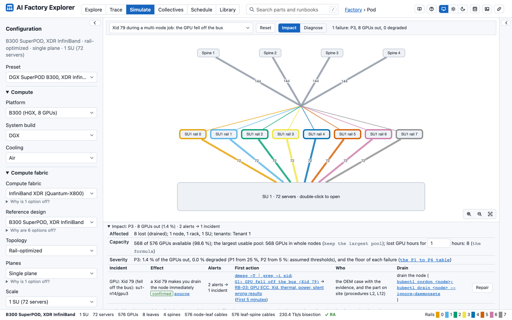
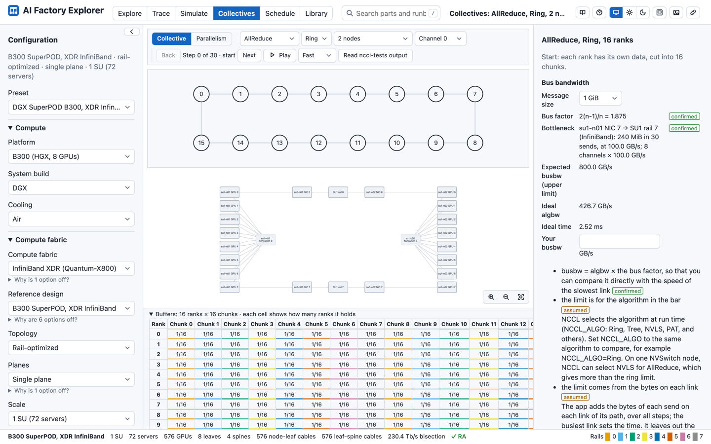
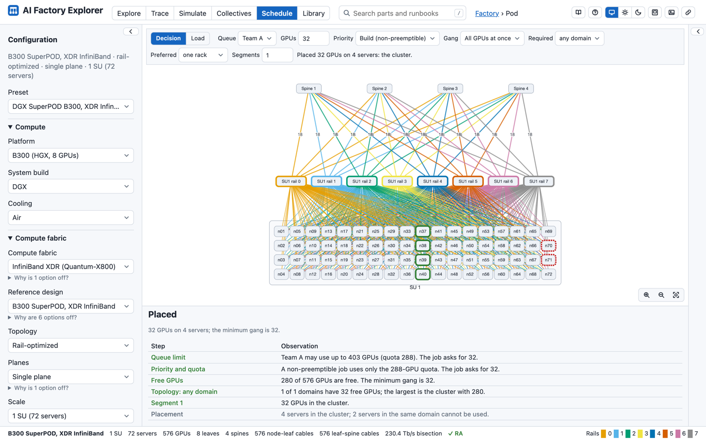

# AI Factory Explorer

[](https://github.com/improving/ai-factory-explorer/actions/workflows/ci.yml)
[](https://github.com/improving/ai-factory-explorer/actions/workflows/image.yml)
[](LICENSE)
[](package.json)

An interactive view of an AI factory, from the internet edge to one GPU.

The Explorer draws the compute fabric, the scalable units, the racks, the servers, and the inside of one server or one NVL72 rack.
It traces a path hop by hop, fails a part and shows the blast radius, models NCCL collectives, and explains why a job is placed or pending.



**Try it without a build:** download `ai-factory-explorer-<tag>.html` from [Releases](../../releases), and open it in a browser.
The file needs no server and no network.

## Why this exists

The topology of an AI factory is spread across reference architectures, cabling tables, runbooks, and dashboards.
The Explorer puts it in one model that a person can walk through:

- **One graph, five scales.** The factory, a scalable unit (SU), a rack, a server, and one GPU.
- **Every value has a provenance.** A value is `confirmed` by a public source, `derived` by a formula, or `assumed` with the reason.
- **The views answer operations questions.** Which rail carries this GPU? What fails when this leaf fails? Why is this job pending?
- **The state is in the URL.** Every view, selection, failure, and guide step has a link that reproduces it.

## What it shows

| Platform | Reference design | Scale |
|---|---|---|
| DGX B300 | DGX SuperPOD, Quantum-X800 XDR InfiniBand | 1, 2, 4, 8, 18 SU |
| DGX B300 | DGX SuperPOD, Spectrum-X Ethernet (dual plane) | 4 SU |
| Dell HGX B300 | Enterprise RA, Spectrum-X Ethernet (dual plane) | 32, 64, 128 nodes |
| DGX H100, DGX H200 | DGX SuperPOD, NDR InfiniBand | 4 SU |
| DGX B200 | DGX SuperPOD, NDR InfiniBand | 1 to 4 SU |
| GB300 NVL72 | DGX SuperPOD, Quantum-X800 XDR InfiniBand | 2, 4, 8, 16 SU |
| GB200 NVL72 | one rack | 1 rack |

Each design can also show a top-of-rack fabric with the same switches.
Top-of-rack is an illustration, not an NVIDIA design; it is there to compare with rail-optimized.

### The fabric and the racks

The fabric view shows the leaves, the spines, the rails, and the servers of each SU.
Select an SU to open its racks from the front or the rear, then open a rack to see its ports and the port map.
The port map compares the design, the site intent (LLD), and the discovery (`ibnetdiscover`), and names each difference: `missing`, `moved`, `wrong rail`, or `extra`.





### The node

The node view shows the GPUs, the NVSwitch chips, the NICs, the CPUs, the ports, the PSUs, the fans, the DIMMs, the drives, and the node services.
The `nvidia-smi topo -m` button opens the GPU and NIC affinity matrix; a click on a cell lights its two parts on the canvas.



### Trace

Trace mode follows the rules of each fabric, not a shortest path: one leaf on the same rail, a spine between rails or groups of SUs, PXN over NVLink, and NVLink in an NVL72 rack.
The hop table gives the link, the bandwidth, the network, the rail, the plane, and the command to check on that hop.
The hop with the lowest sourced bandwidth is the bottleneck.



The tracer also covers the factory paths: GPU to VAST with GDS on or off, the user to the Rafay controller, the operator to a BMC through the PAM, the telemetry of a GPU to a ticket, and the control paths to the switches.

### Simulate and diagnose

Fail a GPU, a cable, a switch, or a UFM unit, or select a scenario.
The impact panel gives the affected GPUs, nodes, racks, SUs, tenants, and services; the capacity and the lost GPU hours; the severity; and one incident for each failure, with its alerts, its first command, and its runbook.

Diagnose shows the chain of one incident, the verdict, and the checklist of a runbook.
The verdict has the four fields of incident operations: `terminal_state`, `sub_domain`, the failure class, and the responsible node.
The timeline exports as Markdown, as the skeleton of a postmortem.



### Collectives

Collectives mode shows how NCCL moves data.
Select the collective, the algorithm, and the scope.
The app draws the ranks, the path of each pair, the buffers, and the busbw limit of the link.
Paste the output of `all_reduce_perf` to compare your run with the model, and open the parallelism mapper to see the groups of TP, CP, EP, DP, and PP.



### Schedule

Schedule mode shows why a job is placed or pending: the queue limit, the priority and the quota, the free GPUs, the topology, each segment, and the placement.
The load model runs 30 minutes of jobs from a seed, with the pending GPUs, the p95 scheduling latency, and the evictions.



### Library

The Library reads the operator documents of this repository inside the app: the 12 runbooks, the reference pages, and the labs.
No link leaves the app, so a reader never reaches a dead page.
The documents are read from disk at build time, so an edit reaches the app on the next build.

### Guides

Seven guided tours open the view of each step and explain what to look at.
The URL keeps the guide and the step, so a link shares the exact step.

## Quick start

You need Node.js 24 or later.

```bash
npm ci
npm run dev
```

Build the single file:

```bash
npm run build
# dist/index.html — open it in a browser, or serve it from any static host
```

## Run it in a container

Build the image:

```bash
docker build -t ai-factory-explorer .
docker run --rm -p 8080:8080 ai-factory-explorer
# open http://localhost:8080
```

Each release also attaches the image as a tarball, so you can run it without a build:

```bash
tag=v0.1.1
curl -L -o ai-factory-explorer-image.tar.gz \
  "https://github.com/improving/ai-factory-explorer/releases/download/${tag}/ai-factory-explorer-${tag}-image.tar.gz"
gunzip -c ai-factory-explorer-image.tar.gz | docker load
docker run --rm -p 8080:8080 "ai-factory-explorer:${tag}"
```

The image workflow also publishes `ghcr.io/improving/ai-factory-explorer-oss` on each push to `main`.
That package is private, because the Improving organization does not allow public packages;
an organization member can pull it after `docker login ghcr.io`.

## Data and provenance

Every value in the inspector carries a badge:

| Badge | Meaning |
|---|---|
| `confirmed` | A public source gives the value; the tooltip names it |
| `derived` | The app computes the value; the tooltip gives the formula |
| `assumed` | No public source gives the value; the tooltip gives the reason |

The Specs tab lists the values that no source confirms, with the note of each one.
A confirmed value would replace the value and its badge.

The design and the sourcing notes of each milestone are in [docs/](docs/README.md).

## How it is built

| Part | Technology |
|---|---|
| UI | React 19, Zustand |
| Graph | Cytoscape.js with preset layouts |
| Documents | `marked`, rewritten at build time by a Vite plugin |
| Build | Vite 8 and `vite-plugin-singlefile` |
| Tests | Vitest (2,100+ unit tests) and Playwright (190+ browser tests) |

The build reads the operator documents (`runbooks/`, `handbook/`, `handson/`) from disk, so the portal and the repository cannot disagree.
`tests/citations.test.ts` checks each cited `file:line`, and `tests/sources.test.ts` checks that each catalog source resolves.

## Repository layout

```text
src/
  catalog/      sourced facts: platforms, switches, NICs, cables, services, failures, lifecycle
  topology/     generate(config) → Graph: fabric, rack, server, NVL72, overview
  views/        Graph → Cytoscape elements and positions for each scale
  routing/      the path tracer and the factory paths
  simulate/     the failure model, the impact, and the severity
  diagnose/     the symptom chain, the verdict, and the timeline
  collectives/  the NCCL model, the buffers, and the busbw limit
  schedule/     the scheduling and load models
  ui/           the React panels, the inspector, and the header
content/        the document allowlist, the build-time reader, and the rewrite
tests/          Vitest unit tests
e2e/            Playwright smoke tests on the built file
docs/           the design record, the sourcing notes, and the screenshots
runbooks/       RB-01 to RB-12: the written operator runbooks
handbook/       the operator reference: commands, hardware matrix, triage, procedures
handson/        the runnable labs that the Library carries
```

## Development

```bash
npm run typecheck   # TypeScript, strict
npm test            # Vitest, including the source of every catalog fact
npm run build       # dist/index.html
npm run e2e         # Playwright against the built file
```

The first `npm run e2e` needs a browser:

```bash
npx playwright install chromium
```

The app makes no request of its own.
The smoke suite fails on a request that leaves the artifact, on a console error, and on a graph that renders slower than 3 s on the CI runner.

## Contributing

Read [CONTRIBUTING.md](CONTRIBUTING.md).
The short version: every value needs a public source, and every view needs a test.
This project follows the [Contributor Covenant](CODE_OF_CONDUCT.md).

## License

[Apache License 2.0](LICENSE).
See [NOTICE](NOTICE) for the third-party software and the content attribution.

## Acknowledgements

The reference-architecture values come from public NVIDIA documentation: the DGX SuperPOD reference architectures, the Enterprise Reference Architecture for HGX AI Factories, the DGX user guides, and the NCCL documentation.
The Explorer is independent of NVIDIA, Rafay, VAST Data, and the other vendors that it describes.
